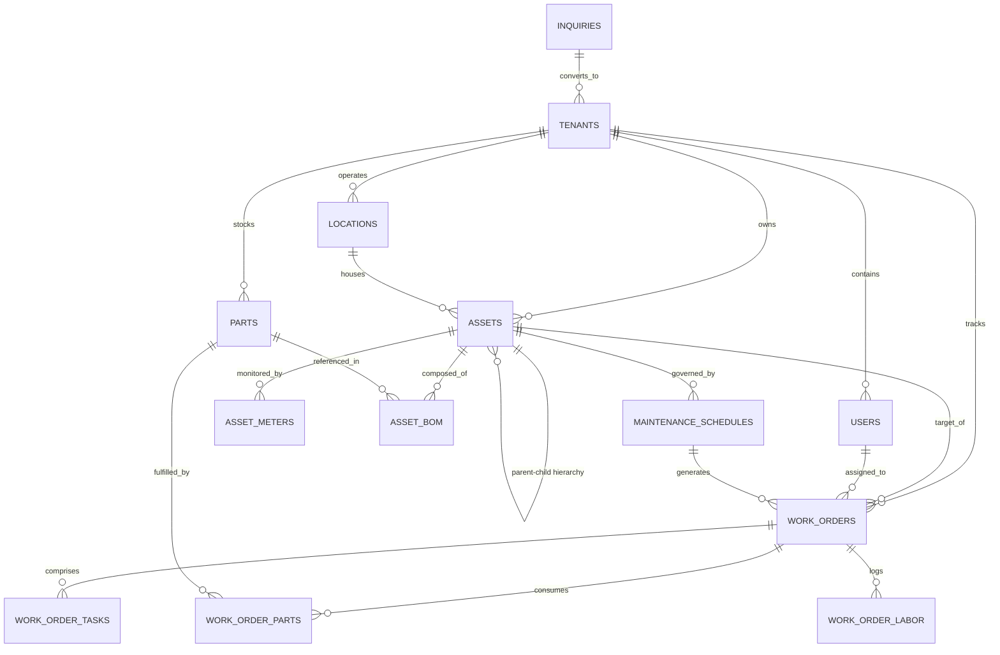
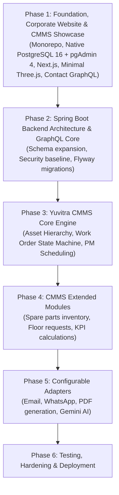

# Yuvitra Labs & Yuvitra CMMS — Master Project Plan & Architecture Blueprint

**Document Version:** 1.2.0  
**Status:** Approved Architectural Baseline & Phased Implementation Plan  
**Role:** Chief Software Architect & Technical Lead  
**Target Enterprise:** Yuvitra Labs (Industrial Software & SaaS Platform)  
**Flagship Solution:** Yuvitra CMMS (Computerized Maintenance Management System)  

---

## 1. Executive Summary & Strategic Objective

Yuvitra Labs is an industrial software venture engineering modern digital solutions for manufacturing, plant operations, and maintenance workflows. The flagship SaaS product, **Yuvitra CMMS**, is designed as an enterprise-grade Computerized Maintenance Management System to digitize asset hierarchies, work orders, preventive maintenance scheduling, and spare parts management.

### Approved Core Directives:
1. **Initial Scope Focus:** Deliver a high-precision corporate website for Yuvitra Labs and a compelling product showcase for Yuvitra CMMS. Full operational CMMS dashboards are deferred to later phases.
2. **Unified Frontend:** Single Next.js (App Router) application handling both corporate marketing pages and future authenticated CMMS routes.
3. **Decoupled Backend:** Independent Java Spring Boot service exposing a strongly typed GraphQL API.
4. **Local Database Architecture (Native Windows):** Native PostgreSQL 16 installed directly on Windows running as an automatic Windows service on default port `5432`, managed visually via **pgAdmin 4**. Spring Boot connects via environment variables. Redis is removed from initial scope to keep development lean.
5. **Docker Desktop Status:** Docker Desktop is **not required** and is completely removed as a development prerequisite. Docker remains strictly an optional deployment target for future production containerization.
6. **Purposeful Visuals:** Three.js 3D elements will remain lightweight, minimal, and purposeful (focusing on responsive industrial digital twin models rather than heavy, distracting visual effects).
7. **Configurable Integrations:** Email, WhatsApp, PDF generation, and AI chatbot services are designed as configurable adapters with local mock fallbacks.
8. **Factual Integrity:** Zero unverified claims, zero fictitious customer results, zero uncertified compliance badges. All portfolio references are explicitly marked for founder verification prior to publication.

---

## 2. Environment & Toolchain Audit

### 2.1 Workspace Status
- **Root Directory:** `E:\YUVITRA_LABS`
- **Source Control:** Git repository initialized on `main` branch (clean working tree).
- **Existing Files:** `.git` directory and `PROJECT_PLAN.md`. No legacy application code or conflicting dependencies exist.

### 2.2 Host Toolchain Diagnostic
| Tool / Runtime | Installed Version | Architectural Role | Status & Action Required |
|---|---|---|---|
| **Node.js** | `v24.11.1` | Frontend runtime (Next.js, TypeScript, Three.js) | Verified & Ready |
| **npm** | `11.6.2` | Frontend package manager | Verified & Ready |
| **Java** | `17.0.16 LTS` (64-Bit) | Backend JVM runtime (Spring Boot 3.x) | Verified & Ready |
| **Git** | `2.48.1.windows.1` | Source code control | Verified & Ready |
| **PostgreSQL 16 & pgAdmin 4** | Native Windows Service (Port `5432`) | Primary relational database & management GUI | **Local Prerequisite:** Install PostgreSQL 16 with pgAdmin 4 on Windows. Configure service to start automatically on port `5432`. Create database `yuvitra_db`. |
| **Maven / Gradle** | Not on system `PATH` | Java build automation | **Standard Action:** Package backend with Maven Wrapper (`./mvnw` / `mvnw.cmd`) for zero-install standalone compilation. |
| **Docker Engine / Desktop** | Not installed / Not supported on host | Optional future containerization | **No action required for development.** Docker Desktop is explicitly removed as a prerequisite. Docker remains optional for future cloud deployment only. |

> [!NOTE]
> **Local Database Prerequisite:** Native PostgreSQL 16 on Windows with pgAdmin 4 running on standard port `5432`. Spring Boot will connect directly via standard JDBC environment variables (`SPRING_DATASOURCE_URL`, `SPRING_DATASOURCE_USERNAME`, `SPRING_DATASOURCE_PASSWORD`) with localhost fallback defaults.

---

## 3. Verified Portfolio Review & Founder Verification Gate

A code-level inspection of the verified production portfolio (`https://yuvaraj-developer-portfolio.vercel.app/`) confirmed the following profile details and historical projects. 

> [!NOTE]
> **Verification Gate:** All items in this section and any public corporate claims are marked `[Pending Founder Verification]` to ensure 100% factual accuracy before public web release.

### 3.1 Verified Professional Background `[Pending Founder Verification]`
- **Founder / Lead:** Yuvaraj R — Full Stack Developer & Technical Trainer (Coimbatore, India).
- **Industry Experience:**
  - Associate Software Engineer at *Maxbyte Technologies* (Sep 2025 – Jul 2026): Industrial software solutions, full-stack workflows, APIs, enterprise application logic.
  - Technical Trainer at *Rathinam Global University* (Aug 2026 – Present): Programming, mentoring, computer science foundations.
  - Web Development Mentor & CSE Teacher at *Beula Matriculation Hr. Sec. School* (Mar 2025 – Aug 2025).
  - Java Full Stack Trainee at *Tap Academy* (May 2024 – Nov 2024).

### 3.2 Verified Portfolio Projects `[Pending Founder Verification]`
1. **Industrial IoT Platform** *(Enterprise)*: Industrial workflows, equipment monitoring, and data-driven application logic (`React`, `Spring Boot`, `PostgreSQL`, `IoT`).
2. **AI Support Platform** *(AI)*: Technical queries, ticket creation, and structured issue handling (`React`, `Spring Boot`, `AI/NLP`, `PostgreSQL`).
3. **WhatsApp Automation** *(Automation)*: Business communication workflows with structured data and notification dispatch (`JavaScript`, `WhatsApp API`, `Excel`, `APIs`).
4. **Student Result Portal** *(Education)*: Structured academic result workflow and role-based permissions (`React`, `Spring Boot`, `PostgreSQL`).
5. **Yuvitra Labs Concept**: *"A space where I experiment with SaaS products, automation ideas and practical software solutions."*

### 3.3 Strict Content & Factual Standards
- **No Uncertified Badges:** Removed all general ISO compliance claims (such as ISO 55000) unless formal third-party certification is attained.
- **No Fictitious Metrics:** Removed unsupported claims such as "Reduce unplanned downtime by X%" or "Resolve breakdowns in 4 minutes".
- **No Invented Case Studies:** No unverified customer logos, fictitious pricing tables, or synthetic testimonials will be displayed.

---

## 4. Scalable Monorepo Architecture

A unified monorepo ensures shared schema validation, synchronized versioning, and streamlined builds across the stack.

### 4.1 Monorepo Directory Layout
```
YUVITRA_LABS/
├── .github/
│   └── workflows/
│       ├── frontend-ci.yml              # Next.js lint, type-check, build
│       └── backend-ci.yml               # Maven test, checkstyle, build
├── apps/
│   ├── web/                             # Unified Next.js 15+ (App Router), React 19, TypeScript
│   │   ├── public/                      # Static assets, lightweight 3D models (.glb), icons
│   │   ├── src/
│   │   │   ├── app/                     # Next.js App Router
│   │   │   │   ├── (marketing)/         # Public Corporate Website & CMMS Showcase
│   │   │   │   │   ├── page.tsx         # Corporate Homepage (Minimal Three.js Hero)
│   │   │   │   │   ├── products/
│   │   │   │   │   │   └── cmms/page.tsx# Yuvitra CMMS Showcase & Interactive Preview
│   │   │   │   │   ├── solutions/page.tsx # Industrial Solutions by Sector
│   │   │   │   │   ├── technology/page.tsx# Architecture, Security & Tech Stack
│   │   │   │   │   ├── about/page.tsx   # About Yuvitra Labs & Engineering Ethos
│   │   │   │   │   └── contact/page.tsx # Inquiries & Demo Request Form
│   │   │   │   ├── (auth)/              # Login / Register (Deferred to later phases)
│   │   │   │   ├── (app)/               # Protected CMMS Dashboard (Deferred to later phases)
│   │   │   │   └── api/                 # Next.js route handlers (Form submission proxies)
│   │   │   ├── components/
│   │   │   │   ├── canvas/              # Lightweight, purposeful Three.js 3D components
│   │   │   │   ├── ui/                  # Atomic industrial design system (buttons, cards, badges)
│   │   │   │   ├── marketing/           # Header, footer, feature grids, architecture diagrams
│   │   │   │   └── showcase/            # Interactive CMMS feature walkthrough widgets
│   │   │   ├── graphql/                 # Generated GraphQL queries and TypeScript types
│   │   │   ├── lib/                     # GraphQL client, utilities
│   │   │   └── styles/                  # Tailwind CSS configuration and dark theme rules
│   │   ├── package.json
│   │   ├── tailwind.config.ts
│   │   ├── tsconfig.json
│   │   └── next.config.ts
│   │
│   └── api/                             # Java 17 + Spring Boot 3.x Backend Service
│       ├── .mvn/wrapper/                # Maven Wrapper binaries
│       ├── mvnw                         # Maven Wrapper shell script (Linux/macOS)
│       ├── mvnw.cmd                     # Maven Wrapper batch script (Windows)
│       ├── pom.xml                      # Spring Boot dependencies & plugins
│       └── src/
│           ├── main/
│           │   ├── java/com/yuvitra/labs/
│           │   │   ├── YuvitraLabsApplication.java
│           │   │   ├── common/          # Exceptions, audit, pagination
│           │   │   ├── config/          # GraphQL, Security, CORS, WebClient configs
│           │   │   ├── security/        # Stateless authentication & authorization guards
│           │   │   └── modules/
│           │   │       ├── contact/     # Demo requests, inquiries & lead intake
│           │   │       ├── asset/       # Asset management domain (prepared for phase 3)
│           │   │       ├── workorder/   # Work order domain (prepared for phase 3)
│           │   │       ├── preventive/  # Maintenance schedules (prepared for phase 3)
│           │   │       ├── inventory/   # Spare parts catalog (prepared for phase 4)
│           │   │       └── integration/ # Configurable adapters (Email, WhatsApp, PDF, AI)
│           │   └── resources/
│           │       ├── application.yml  # Environment-driven database & integration configs
│           │       ├── graphql/         # GraphQL schema files (*.graphqls)
│           │       └── db/migration/    # Flyway SQL migrations (V1__, V2__)
│           └── test/                    # JUnit 5 & Mockito test suites
│
├── packages/
│   └── graphql-schema/                  # Canonical GraphQL schema definitions & codegen
│       ├── schema.graphqls
│       └── package.json
│
├── infrastructure/
│   ├── database/                        # Native PostgreSQL local setup scripts & SQL seeds
│   │   └── init-db.sql                  # Database creation & user grants
│   └── docker/                          # (Optional) Dockerfiles for future production cloud builds
│       ├── Dockerfile.web
│       └── Dockerfile.api
│
├── docs/
│   ├── adr/                             # Architecture Decision Records
│   ├── api/                             # GraphQL schema documentation
│   └── runbooks/                        # Native PostgreSQL setup guide & operational runbooks
│
├── .gitignore
├── .editorconfig
└── PROJECT_PLAN.md
```

---

## 5. Website Architecture & Yuvitra CMMS Showcase

### 5.1 Public Corporate Website Pages (Initial Focus)
The primary deliverable of Phase 1 is a website that conveys engineering excellence and industrial precision.

1. **Homepage (`/`)**:
   - Clean, high-precision dark industrial theme with amber and cyan telemetry accents.
   - **Minimal & Purposeful Three.js Hero:** A lightweight, optimized 3D digital twin of industrial machinery (smooth orbital view, low-poly geometry, non-intrusive annotations, 60fps performance without draining client resources).
   - Core value proposition: Unifying asset tracking, structured maintenance workflows, and data-driven maintenance planning.
   - Interactive Yuvitra CMMS feature teaser.
   - Direct link to technical architecture and demo scheduling.
2. **Yuvitra CMMS Product Showcase (`/products/cmms`)**:
   - Comprehensive interactive walkthrough of the upcoming SaaS modules:
     - *Asset Hierarchy:* Multi-tier plant and equipment structure.
     - *Work Order Management:* Digital dispatching, status tracking, and technician sign-off.
     - *Preventive Maintenance:* Time-based and meter-based maintenance schedules.
     - *Spare Parts Catalog:* Bill of materials and low-stock alerts.
   - Interactive UI mockups and simulated workflow demonstrations (no operational database required for public demonstration).
3. **Industry Solutions (`/solutions`)**:
   - Focused perspectives for:
     - Discrete Manufacturing (Machinery, fabrication, assembly plants).
     - Heavy Machinery & Equipment fleets.
     - Process & Facilities Maintenance (HVAC, utilities, industrial infrastructure).
4. **Technology & Engineering (`/technology`)**:
   - Deep dive into the architectural principles behind Yuvitra Labs:
     - Robust Java Spring Boot backend with strong transactional guarantees.
     - PostgreSQL relational integrity.
     - Modern Next.js frontend with GraphQL for zero-overfetching API communication.
     - Edge-to-cloud security posture.
5. **About Yuvitra Labs (`/about`)**:
   - Company vision, technical ethos, and founding story `[Pending Founder Verification]`.
6. **Contact & Request Demo (`/contact`)**:
   - Lead intake form capturing plant size, equipment scope, and technical inquiries.
   - Backed by the Spring Boot GraphQL backend mutation `submitContactInquiry`.

### 5.2 Yuvitra CMMS Operational SaaS Modules (Architecture Preserved for Phase 3 & 4)
The operational CMMS dashboard is intentionally deferred from Phase 1. Its architectural design is preserved for seamless transition in subsequent phases:
- **Module 1: Hierarchical Asset Registry (`/app/assets`)** — Enterprise, site, line, machine, component hierarchy with QR code tags.
- **Module 2: Work Order Lifecycle (`/app/work-orders`)** — Corrective and preventive jobs, Kanban status workflows, task checklists, labor logs.
- **Module 3: Preventive Maintenance Engine (`/app/maintenance`)** — Calendar triggers, meter runtime triggers, automated generation.
- **Module 4: Spare Parts & Inventory (`/app/inventory`)** — SKUs, warehouse bins, machine BOM, stock movement logs.
- **Module 5: Floor Request Portal (`/app/requests`)** — Quick issue submission for plant floor operators.
- **Module 6: Maintenance KPIs & Analytics (`/app/analytics`)** — MTBF, MTTR, PM compliance ratios, cost tracking.

---

## 6. PostgreSQL Relational Data Model (Native Windows Service)

PostgreSQL 16 runs directly as a native Windows service listening on default port `5432`, managed visually via **pgAdmin 4**. Redis has been removed from the initial scope to eliminate unnecessary runtime dependencies.

Spring Boot connects directly using standard JDBC environment variables configured in `apps/api/src/main/resources/application.yml`:
```yaml
spring:
  datasource:
    url: ${SPRING_DATASOURCE_URL:jdbc:postgresql://localhost:5432/yuvitra_db}
    username: ${SPRING_DATASOURCE_USERNAME:postgres}
    password: ${SPRING_DATASOURCE_PASSWORD:postgres}
    driver-class-name: org.postgresql.Driver
    hikari:
      maximum-pool-size: 10
      minimum-idle: 2
      idle-timeout: 300000
      connection-timeout: 20000
```



### 6.1 Database Schema Outline

#### Phase 1: Inquiries & Scaffolding Schema
- `inquiries`:
  - `id (UUID PK)`
  - `full_name (VARCHAR 100)`
  - `work_email (VARCHAR 150)`
  - `company_name (VARCHAR 150)`
  - `phone_number (VARCHAR 50)`
  - `inquiry_type (DEMO_REQUEST, GENERAL_INQUIRY, PARTNERSHIP)`
  - `message (TEXT)`
  - `status (NEW, CONTACTED, QUALIFIED, ARCHIVED)`
  - `created_at (TIMESTAMP WITH TIME ZONE)`

#### Future Phase: Core CMMS Schema (Preserved for Phases 2–4)
- `tenants`: Multi-tenant organization boundaries.
- `users`, `roles`, `user_roles`: Role-based access control.
- `locations`: Hierarchical sites, plants, and production lines.
- `assets`, `asset_meters`, `asset_documents`, `asset_bom`: Complete machinery digital twin.
- `work_orders`, `work_order_tasks`, `work_order_labor`, `work_order_parts`: Maintenance execution records.
- `maintenance_schedules`: Recurrence and meter thresholds.
- `parts`, `stock_levels`, `inventory_transactions`: Spare parts catalog.
- `audit_logs`: Detailed compliance change tracking.

---

## 7. GraphQL API Boundaries

Spring for GraphQL provides a strongly typed API contract between the Next.js frontend and the Spring Boot backend.

```graphql
# Common Enums & Types
enum InquiryType {
  DEMO_REQUEST
  GENERAL_INQUIRY
  PARTNERSHIP
}

enum InquiryStatus {
  NEW
  CONTACTED
  QUALIFIED
  ARCHIVED
}

type SubmissionResponse {
  success: Boolean!
  message: String!
  referenceId: String
}

# Root Queries
type Query {
  # Public & Product Queries
  healthCheck: String!
  productModules: [ProductModuleInfo!]!
  
  # Future Authenticated Context (Deferred)
  me: UserProfile
  assetById(id: ID!): AssetDetail
  workOrders(status: String, page: Int, size: Int): WorkOrderConnection
}

type ProductModuleInfo {
  id: ID!
  slug: String!
  title: String!
  summary: String!
  features: [String!]!
}

# Root Mutations
type Mutation {
  # Public Intake
  submitContactInquiry(input: ContactInquiryInput!): SubmissionResponse!

  # Future Operational Mutations (Deferred)
  createAsset(input: CreateAssetInput!): AssetDetail
  createWorkOrder(input: CreateWorkOrderInput!): WorkOrderDetail
}

input ContactInquiryInput {
  fullName: String!
  workEmail: String!
  companyName: String!
  phoneNumber: String
  inquiryType: InquiryType!
  message: String
}
```

---

## 8. Configurable External Integrations Architecture

All external integrations are architected with **pluggable adapters and configuration flags** in `application.yml` and Next.js environment files. They default to local mock/console implementations so that development and testing require zero third-party accounts or incurred costs.

```
+-------------------------------------------------------------+
|              Spring Boot Integration Engine                 |
|                                                             |
|  +------------------+    +------------------+               |
|  |   EmailService   |--->|  MockEmailService| (Default)     |
|  |   (Interface)    |--->|  ResendAdapter   | (Configured)  |
|  +------------------+    +------------------+               |
|                                                             |
|  +------------------+    +------------------+               |
|  | WhatsAppService  |--->|MockWhatsAppServ..| (Default)     |
|  |   (Interface)    |--->|TwilioCloudAdapter| (Configured)  |
|  +------------------+    +------------------+               |
|                                                             |
|  +------------------+    +------------------+               |
|  |  AiChatService   |--->|   MockAiService  | (Default)     |
|  |   (Interface)    |--->|  GeminiAiAdapter | (Configured)  |
|  +------------------+    +------------------+               |
|                                                             |
|  +------------------+    +------------------+               |
|  |  PdfReportEngine |--->| OpenPDF Generator| (Native Java) |
|  +------------------+    +------------------+               |
+-------------------------------------------------------------+
```

### 8.1 Integration Specifications
1. **Transactional Email Service:**
   - *Adapter Interface:* `EmailService`
   - *Active Default:* `MockEmailService` (logs formatted email to terminal/logger).
   - *Production Option:* Resend / SendGrid / Spring Mail via configuration property `integrations.email.provider=mock|resend|sendgrid`.
2. **WhatsApp Notification Service:**
   - *Adapter Interface:* `WhatsAppService`
   - *Active Default:* `MockWhatsAppService` (logs payload to terminal).
   - *Production Option:* Meta WhatsApp Cloud API / Twilio via `integrations.whatsapp.enabled=false|true`.
3. **PDF Generation Service:**
   - *Technology:* Native Java OpenPDF / iText library (zero external cloud dependencies).
   - *Use Case:* Generation of equipment QR sheets and work order summary cards.
4. **AI Troubleshooting Assistant:**
   - *Adapter Interface:* `AiAssistantService`
   - *Active Default:* `MockAiAssistantService` (returns curated diagnostic guidelines).
   - *Production Option:* Spring AI with Google Gemini API via `integrations.ai.provider=mock|gemini`.

---

## 9. Non-Functional Requirements & Engineering Guidelines

### 9.1 Purposeful & Minimal Three.js Strategy
- **Restraint:** 3D visualizations must serve a clear purpose—specifically representing industrial machinery components and telemetry markers—rather than decorative animations.
- **Performance Budget:** Maximum 3D asset footprint under 1.5 MB using Draco-compressed `.glb` format.
- **Graceful Fallback:** If WebGL is unavailable or low frame-rates are detected, the canvas automatically degrades to high-resolution vector/SVG technical diagrams.
- **Lifecycle Management:** Three.js render loops pause automatically when the canvas scrolls out of viewport (`IntersectionObserver`).

### 9.2 Security Baseline
- **Stateless Tokens:** JWT-based authentication for APIs; passwords hashed with BCrypt (cost 12).
- **Sanitization:** Jakarta Bean Validation on all backend inputs; parameterized SQL queries through Spring Data JPA.
- **Security Headers:** Strict Content Security Policy (CSP), CORS whitelisting, frame-ancestors restrictions.
- **Multi-Tenancy Assurance:** Tenant ID scoping baked into JPA repository interfaces for future SaaS phases.

### 9.3 Infrastructure & Local Development
- **Local PostgreSQL:** Native Windows installation of PostgreSQL 16 on default port `5432`, managed visually via **pgAdmin 4**.
- **Windows Service Automation:** PostgreSQL configured to start automatically as a Windows service (`postgresql-x64-16`) in `services.msc`.
- **Environment-Driven Configuration:** Spring Boot dynamically connects to PostgreSQL via environment variables:
  - `SPRING_DATASOURCE_URL` (Defaults to `jdbc:postgresql://localhost:5432/yuvitra_db`)
  - `SPRING_DATASOURCE_USERNAME` (Defaults to `postgres`)
  - `SPRING_DATASOURCE_PASSWORD` (Defaults to `postgres`)
- **Docker Role:** Strictly optional for future production container packaging and cloud deployment. Zero Docker runtime dependency on the local Windows development machine.
- **No Redis Dependency:** Initial phases operate without Redis; in-memory caching (ConcurrentHashMap / Caffeine) is used if required.

---

## 10. Phased Implementation Roadmap



### Phase 1: Foundation, Corporate Website & CMMS Showcase *(Current Phase)*
1. Set up monorepo structure: `apps/web`, `apps/api`, `packages/graphql-schema`, `infrastructure/database`, and `docs/`.
2. Configure local native PostgreSQL 16 database (`yuvitra_db`) via pgAdmin 4 on port `5432` and verify connection.
3. Scaffold unified Next.js 15+ application with TypeScript and Tailwind CSS.
4. Scaffold independent Spring Boot 3.x backend with Maven Wrapper, Spring for GraphQL, and environment-driven PostgreSQL configuration.
5. Implement purposeful, minimal Three.js industrial visualizer hero.
6. Build complete public corporate website (Home, Solutions, Technology, About, Contact).
7. Build Yuvitra CMMS Product Showcase page with interactive feature walkthroughs.
8. Wire contact/demo inquiry mutation from Next.js to Spring Boot and PostgreSQL.

### Phase 2: Spring Boot Backend Architecture & GraphQL Core
1. Formulate Flyway migration scripts for tenancy, users, and core schemas.
2. Implement Spring Security with JWT filters and role guards.
3. Establish GraphQL type generation pipeline (`@graphql-codegen`).

### Phase 3: Yuvitra CMMS Core Engine
1. Implement Asset Hierarchy domain and resolvers (recursive location/asset tree).
2. Implement Work Order domain, state machine, and status transitions.
3. Implement Preventive Maintenance scheduling engine (time and meter triggers).

### Phase 4: CMMS Extended Modules
1. Implement Spare Parts & Inventory domain with BOM mapping and stock movements.
2. Implement Floor Request submission and triage portal.
3. Implement maintenance analytics calculations (MTBF, MTTR, PM compliance).

### Phase 5: Configurable External Integrations
1. Implement mock and active adapters for Email (Resend/SendGrid).
2. Implement mock and active adapters for WhatsApp notifications.
3. Implement embedded Java PDF generator for work order travel sheets.
4. Implement AI diagnostic assistant adapter (Spring AI + Gemini).

### Phase 6: Testing, Hardening & Deployment
1. Write JUnit 5 / Mockito backend unit and integration tests.
2. Write frontend component and end-to-end tests.
3. Configure GitHub Actions CI workflows.
4. Create optional production multi-stage Dockerfiles.

---

## 11. Approved Architectural Decisions Summary

| Decision Area | Approved Choice | Implementation Strategy |
|---|---|---|
| **Local Database** | **Native PostgreSQL 16 on Windows** | Installed directly on Windows, configured as an automatic Windows service on default port `5432`, managed with **pgAdmin 4**. Spring Boot connects via environment variables (`SPRING_DATASOURCE_URL`, `SPRING_DATASOURCE_USERNAME`, `SPRING_DATASOURCE_PASSWORD`). |
| **Docker Desktop** | **Removed as Prerequisite (Optional for Future)** | Zero requirement for Docker Desktop during local development. Docker remains strictly an optional target for future cloud packaging and containerized deployments. |
| **Caching Layer** | **Removed from Initial Scope** | Redis deferred. Rely on standard PostgreSQL indexing and JVM in-memory caching. |
| **Frontend Strategy** | **Unified Next.js App** | Single Next.js application in `apps/web` handling marketing routes and future SaaS portal. |
| **Backend Strategy** | **Independent Spring Boot API** | Decoupled Spring Boot 3 service in `apps/api` with Spring for GraphQL and Maven Wrapper. |
| **Phase 1 Focus** | **Website & Product Showcase** | Corporate website, CMMS product tour, interactive previews, and demo intake. Full operational CMMS dashboard deferred to Phase 3/4. |
| **Three.js Scope** | **Minimal & Purposeful** | Lightweight industrial 3D digital twin model; low-poly, optimized performance, non-intrusive. |
| **External Services** | **Configurable Adapters** | Feature-flagged services defaulting to local mock implementations for zero-cost development. |
| **Factual Governance** | **Founder Verification Gate** | All portfolio projects and company statements flagged `[Pending Founder Verification]`; zero unverified claims. |

---
*End of Master Project Plan & Architecture Blueprint v1.2.0.*
